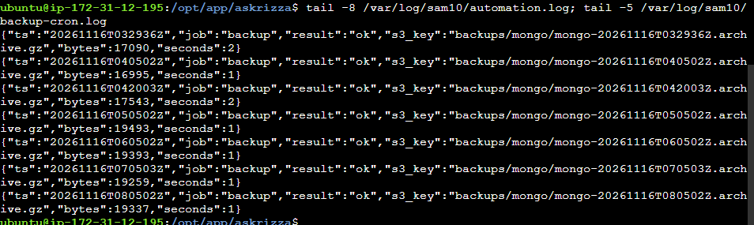
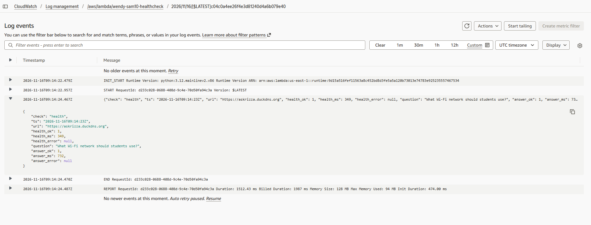
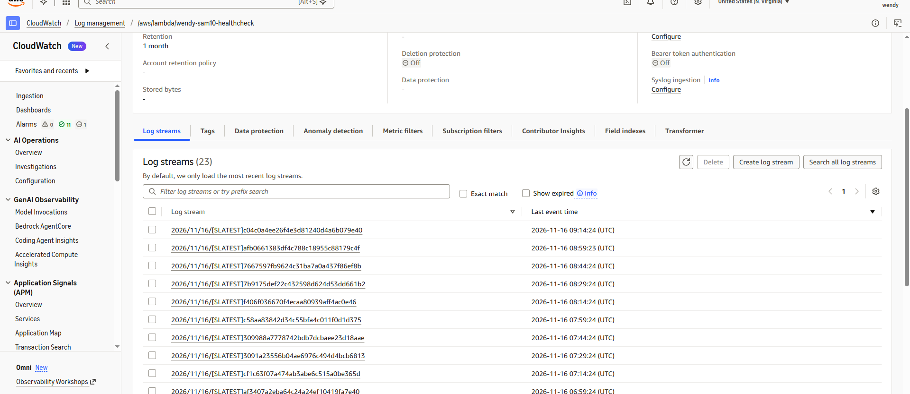
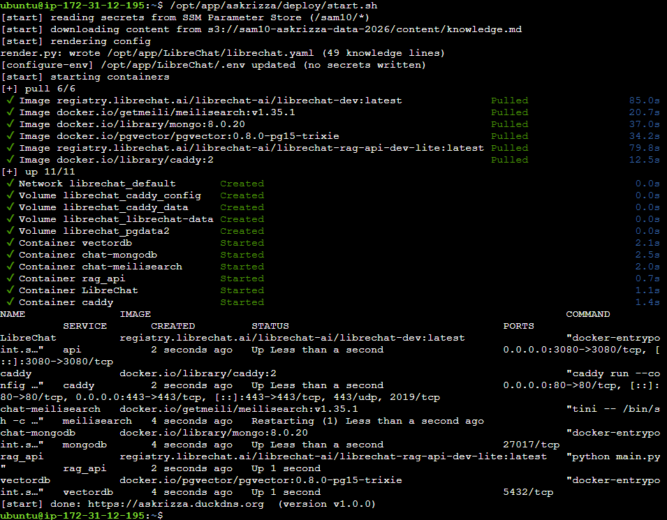
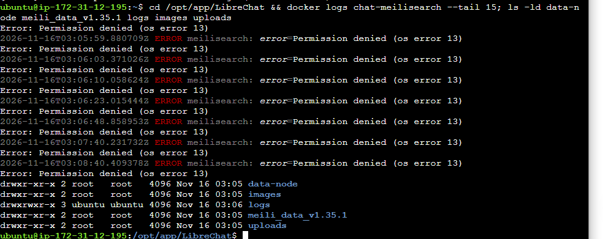
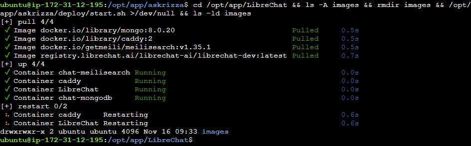
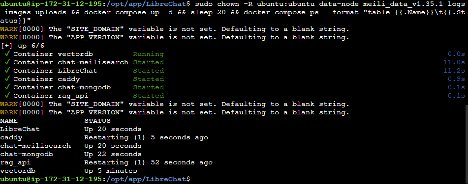

The project had three kinds of event:

- <span class="tag tag-auto">Automated</span> scheduled jobs that run without anyone touching them
- <span class="tag tag-real">Real incident</span> a failure I didn't plan, found and fixed
- <span class="tag tag-drill">Simulated failure</span> a failure I caused on purpose to test something (the [outage drill](operations.html#proof-an-alert-reaches-a-person) and the [restore test](operations.html#the-restore-test))

## Two automations

| | What it does | When | Code | Logs |
|---|---|---|---|---|
| <span class="tag tag-auto">1</span> | **Backs up MongoDB to S3**, and emails me through SNS if it fails | cron, 5 minutes past every hour | `scripts/backup.sh` | `/sam10/automation` |
| <span class="tag tag-auto">2</span> | **Checks AskRizza from outside**: calls `/health` and asks Gemini one known question, then publishes the results as metrics for the alarms | EventBridge, every 15 minutes, runs the Lambda `wendy-sam10-healthcheck` | `lambda/healthcheck.py` | `/aws/lambda/wendy-sam10-healthcheck` |

Both are in the [repository]({{ site.repo_url }}), and its README explains how to deploy them. I chose hourly and every 15 minutes rather than nightly so that, in a project built over a few days, each automation could prove itself many times. Hourly backups also give a better RPO, and each one is only about 17 KB.

### Runs nobody started
- **Backup:** 16 Nov at 04:05, 05:05, 06:05, 07:05 and 08:05 UTC, all `"result":"ok"`, about 1 second each. The 03:29 and 04:20 runs were mine, by hand.
- **Health check:** every 15 minutes since about 04:00 UTC on 16 Nov: 23 runs by 09:14, at :59, :14, :29 and :44 past each hour.

The 09:14 run in detail: the site answered `/health` in 349 ms, and Gemini answered the Wi-Fi question correctly ("RP-Student") in 732 ms.

<div class="split">
<div markdown="1">

</div>
<div markdown="1">

</div>
</div>

<details class="more">
<summary>More automation evidence</summary>
<div class="more-body" markdown="1">


</div>
</details>

## Incident: the search service kept crashing
<span class="tag tag-real">Real incident</span> 16 Nov 2026, during the first deployment

<ol class="timeline">
  <li><time>03:05:59 UTC</time><strong>It started</strong><span>Meilisearch, the chat-search service, logged its first error.</span></li>
  <li><time>~03:06</time><strong>I noticed</strong><span>The deploy output listed <code>chat-meilisearch  Restarting (1)</code>. No monitoring existed yet. I caught it by reading the output.</span></li>
  <li><time>~03:09</time><strong>Diagnosed</strong><span>Its log said <code>Permission denied (os error 13)</code> every few seconds, and its data folders were owned by root.</span></li>
  <li class="key"><time>03:12:24 UTC</time><strong>Fixed</strong><span>Corrected the folder owners and redeployed. Meilisearch has been running ever since (its start time, from <code>docker inspect</code>).</span></li>
</ol>

**Time to detect:** under a minute, by reading the deploy output. Today, the 5xx or site-down alarms would catch a failure like this as well. **Time to fix:** about 6½ minutes.

**Effect:** chat search didn't work. Worse, MongoDB had the same problem waiting to happen. Its folder was also owned by root, so it would have failed as soon as it needed to write new files, and that would have broken logins and chat history.

<div class="compare">
<div class="compare-col before" markdown="1">
#### Symptom

</div>
<div class="compare-col before" markdown="1">
#### Diagnosis

</div>
</div>

### Root cause
LibreChat runs its containers as a normal user (UID 1000) and keeps their data in folders next to its configuration. On a brand-new server those folders didn't exist yet, and when a folder doesn't exist, **Docker creates it as root**. The containers couldn't write to their own data folders, so Meilisearch exited on its first write, and Docker restarted it again and again.

In one line: *nothing created the data folders as the app user before Docker did, so Docker created them as root, and the non-root containers couldn't write to them.*

### Fix
```bash
sudo chown -R ubuntu:ubuntu data-node meili_data_v1.35.1 logs images uploads
/opt/app/askrizza/deploy/start.sh
```

### Prevention, and proof it works
`deploy/start.sh` now **creates every data folder as the app user before starting the containers**, so Docker never gets the chance to create them as root. It reads the Meilisearch folder's name from LibreChat's own configuration, so it keeps working when that version changes.

To prove it, on 16 Nov at 09:33 UTC I deleted the empty `images` folder and redeployed. It came back **owned by `ubuntu`, not root**, and all four containers stayed up.



### Found in the same deployment
- **The document-search API was also crash-looping** ("Missing credentials… OPENAI_API_KEY"). It needs an OpenAI key that this project doesn't have and doesn't need, so I switched it and its database off.
- **Config changes didn't take effect.** LibreChat reads its settings only when it starts, so closing sign-up needed a restart. `start.sh` now restarts the app on every deploy.

## Runbook: a container keeps restarting

<div class="callout">
<strong>Owner:</strong> Wendy (SAM10) · <strong>Last tested:</strong> 16 Nov 2026 · <strong>Takes:</strong> about 10 minutes · <strong>Ask:</strong> Wendy
</div>

**1. What this is for.** Getting AskRizza healthy again when one of its containers is crash-looping.

**2. How I know I need it.** The `askrizza-http-5xx` or `askrizza-site-down` alarm emails me, or someone reports errors or broken chat search. On `askrizza-prod` (Session Manager, then `sudo su - ubuntu`):
```bash
cd /opt/app/LibreChat && docker compose ps --format "table {{ '{{' }}.Name}}\t{{ '{{' }}.Status}}"
```
One row says `Restarting (n)` instead of `Up`.

**3. What it affects.** LibreChat down: the whole site is down (502). MongoDB down: no logins or chat history. Meilisearch down: chat search fails.

**4. How to fix it.**
1. Read the error: `docker logs <container> --tail 30`. Expect a reason such as `Permission denied`, `Missing credentials` or out of memory.
2. **Permission denied:** check the owners with `ls -ld data-node meili_data_v* images uploads logs`. For any owned by root: `sudo chown -R ubuntu:ubuntu <folder>`.
3. **Missing credentials:** check the parameter exists with `aws ssm get-parameter --name /sam10/<NAME> --query Parameter.Name`.
4. **Out of memory:** check `free -m`, `docker stats --no-stream` and the memory alarm.
5. Redeploy **with the script**: `/opt/app/askrizza/deploy/start.sh`. Every container should be `Up`.

**5. How to check it worked.**
- `docker compose ps` shows every container `Up` and none `Restarting`
- AskRizza answers "What Wi-Fi network should students use?" with RP-Student
- No new alarms for 10 minutes, and the next health-check run logs `"health_ok": 1, "answer_ok": 1`

**6. How to undo it.** `chown` and `start.sh` are safe to repeat. If a deploy makes things worse, check out the previous commit (`git -C /opt/app/askrizza checkout <commit>`) and run `start.sh` again.

**7. Gotchas.**
- **Never run `docker compose up` by itself.** It recreates the containers without the secrets and the domain, which only `start.sh` loads. Caddy then crash-loops and LibreChat starts with no keys. It happened to me once during this incident, and re-running `start.sh` fixed it. (`docker compose ps`, `logs` and `restart`, and `docker start` and `stop`, are safe.)
- Config and content changes only apply after a restart, which `start.sh` does.
- Docker commands go in the server's terminal (`ubuntu@ip-…`), not in CloudShell.
- Content changes go: repository → S3 (`aws s3 cp` in CloudShell) → `start.sh` → test in a **new** chat.
- Scripts committed from Windows can lose their executable bit. Fix with `chmod +x deploy/*.sh scripts/*.sh`, or store it in git with `git update-index --chmod=+x`.



**8. Change history.**
- 16 Nov 2026: written after the Meilisearch permission incident
- 16 Nov 2026: added the content-path and executable-bit gotchas
