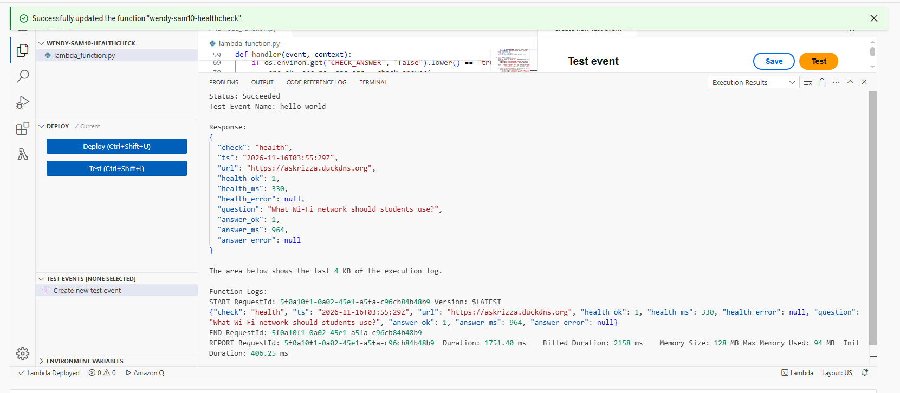

# Automations

Both automations live in the repository with real commits. The [README](https://github.com/Wendy-Calma/sam10-calma-wendy-askrizza-ops#readme) explains how to deploy them.

| # | What | Schedule | Code | Log |
|---|---|---|---|---|
| 1 | **MongoDB backup to S3.** Alerts through SNS if it fails. | cron, **:05 every hour** | `scripts/backup.sh`, `scripts/install-automation.sh` | `/var/log/sam10/automation.log`, shipped to CloudWatch `/sam10/automation` |
| 2 | **External health and answer check.** `GET /health`, plus one test question to the model. Publishes metrics that the alarms watch. | EventBridge `rate(15 minutes)` → Lambda `wendy-sam10-healthcheck` | `lambda/healthcheck.py` | `/aws/lambda/wendy-sam10-healthcheck` |

**Why hourly and every 15 minutes:** the project was built in a few days, not five weeks. Short schedules collect enough unattended runs to prove the automations work. Hourly backups also give a better RPO than nightly ones, at almost no cost (each dump is about 17 KB).



## Unattended runs
✏️ *Insert screenshots of (a) CloudWatch Logs `/sam10/automation`, showing several hourly `"job":"backup","result":"ok"` lines, and (b) `/aws/lambda/wendy-sam10-healthcheck`, showing several runs 15 minutes apart. Then list a few timestamps here:*

| Automation | Unattended run timestamps (UTC) |
|---|---|
| Backup | ✏️ e.g. 2026-11-16 05:05, 06:05, 07:05 … |
| Health check | ✏️ e.g. 2026-11-16 04:15, 04:30, 04:45 … |

---

# Incident: search service crash-looping (Permission denied)

## What happened

| | Time (UTC, 16 Nov 2026) |
|---|---|
| Started: first deploy; `chat-meilisearch` starts failing | **03:05:59** (first error in its log) |
| Noticed: `start.sh` output shows `chat-meilisearch  Restarting (1)` | ~03:06 |
| Diagnosed: `docker logs` plus folder ownership | ✏️ ~03:1x |
| Fixed: `chown`, all containers Up | ✏️ ~03:1x |

**Time to detect:** under 1 minute, by reading the deploy output. **This was before monitoring existed.** Today the CPU or 5xx alarms would also catch it. **Time to fix:** ✏️ about N minutes.

**Effect:** chat search was down. MongoDB had the same fault waiting to happen: its data folder was also owned by root, so it would have failed as soon as it needed to write new files. That would have broken logins and chat history.

## Investigation

```
$ docker logs chat-meilisearch --tail 15
ERROR meilisearch: error=Permission denied (os error 13)      (repeated every few seconds)

$ ls -ld data-node meili_data_v1.35.1 logs images uploads
drwxr-xr-x 2 root   root   ... data-node
drwxr-xr-x 2 root   root   ... images
drwxrwxr-x 3 ubuntu ubuntu ... logs
drwxr-xr-x 2 root   root   ... meili_data_v1.35.1
drwxr-xr-x 2 root   root   ... uploads
```
✏️ *Insert your screenshots of both outputs (E-15).*

## Root cause
LibreChat's compose file runs its containers as the app user (`user: "${UID}:${GID}"`, UID 1000), and stores their data in **bind-mounted folders** next to the compose file. On a fresh server those folders didn't exist yet. **Docker creates a missing bind-mount folder as `root`**, so the containers, running as UID 1000, couldn't write to their own data folders. Meilisearch exits with code 1 on its first write, and `restart: always` restarts it, so it loops forever.

Not "the service was restarted", but: *the data folders were created by Docker as root, because nothing created them first as the app user; the non-root containers couldn't write; Meilisearch crashed on start and looped.*

## Fix
```bash
sudo chown -R ubuntu:ubuntu data-node meili_data_v1.35.1 logs images uploads
/opt/app/askrizza/deploy/start.sh
```

## Prevention
`deploy/start.sh` now **creates every data folder as the app user before starting the containers**, so Docker never has to create them as root. The Meilisearch folder name is read from the compose file, so it still works when LibreChat upgrades Meilisearch.

```bash
MEILI_DIR="$(grep -o 'meili_data_v[0-9.]*' "$LC_DIR/docker-compose.yml" | head -1)"
mkdir -p "$LC_DIR/data-node" "$LC_DIR/images" "$LC_DIR/uploads" "$LC_DIR/$MEILI_DIR" ...
```

**Evidence it works:** ✏️ *Run this on the server and screenshot it. It removes an empty data folder, redeploys, and shows the folder is recreated owned by `ubuntu`, not root:*
```bash
cd /opt/app/LibreChat && ls -A images && rmdir images && /opt/app/askrizza/deploy/start.sh >/dev/null && ls -ld images
```

## Related findings during the same deploy
- **rag_api crash-loop** (`Missing credentials… OPENAI_API_KEY`). Document search needs an OpenAI embeddings key that this project doesn't have and doesn't need. Fixed by disabling `rag_api` and `vectordb` with a compose profile.
- **Config changes not applied.** LibreChat reads `.env` and `librechat.yaml` only at start-up, so closing registration needed a restart. `start.sh` now restarts the app on every deploy.

---

# Runbook: a container keeps restarting

```
Owner: Wendy (SAM10)   Last tested: 16 Nov 2026   Takes: ~10 min   Ask: Wendy
```

**1. What this is for.** Getting AskRizza healthy again when one of its containers is crash-looping.

**2. How you know you need it.**
- The `askrizza-http-5xx` or `askrizza-site-down` alarm emails you, or a user reports errors or missing chat search.
- Session Manager on `askrizza-prod`, then `sudo su - ubuntu`:
```bash
cd /opt/app/LibreChat && docker compose ps --format "table {{.Name}}\t{{.Status}}"
```
A row says `Restarting (n)`, not `Up`.

**3. What it affects.** LibreChat down means the whole site is down (502). MongoDB down means no login or chat history. Meilisearch down means chat search fails.

**4. How to fix it.**
- Step 1: read the error. Run `docker logs <container> --tail 30`. You should see the reason, e.g. `Permission denied`, `Missing credentials`, or out of memory.
- Step 2a: if it says **Permission denied**, check owners with `ls -ld data-node meili_data_v* images uploads logs`. Any owned by `root`? Run `sudo chown -R ubuntu:ubuntu <those folders>`.
- Step 2b: if it's **missing credentials or keys**, check the parameter exists with `aws ssm get-parameter --name /sam10/<NAME> --query Parameter.Name`.
- Step 2c: if it's **out of memory**, check `free -m` and `docker stats --no-stream`, and look at the memory alarm.
- Step 3: redeploy **with the script**: `/opt/app/askrizza/deploy/start.sh`. You should see every container `Up`.

**5. How to check it worked.**
- [ ] `docker compose ps` shows every container `Up`, none `Restarting`
- [ ] Ask AskRizza "What Wi-Fi network should students use?" and get "RP-Student"
- [ ] No new alarms for 10 minutes. The next health-check run logs `"health_ok": 1, "answer_ok": 1`.

**6. How to undo it.** `chown` and `start.sh` are safe to repeat. If a deploy makes things worse, check out the previous commit (`git -C /opt/app/askrizza checkout <previous-commit>`) and run `start.sh` again.

**7. Gotchas.**
- **Never run `docker compose up` on its own.** It recreates containers **without the secrets** and the domain, which only `start.sh` loads from SSM. Caddy then crash-loops and LibreChat starts with no keys. (`docker compose ps`, `logs`, `restart`, and `docker start/stop` are safe.)
- Config and content changes only apply after the app restarts, which `start.sh` does.
- Docker commands go in the **server** terminal (`ubuntu@ip-…`), not CloudShell.

**8. Change history.**
- 16 Nov 2026: written after the Meilisearch permission incident. Added the "never run compose up directly" gotcha.
