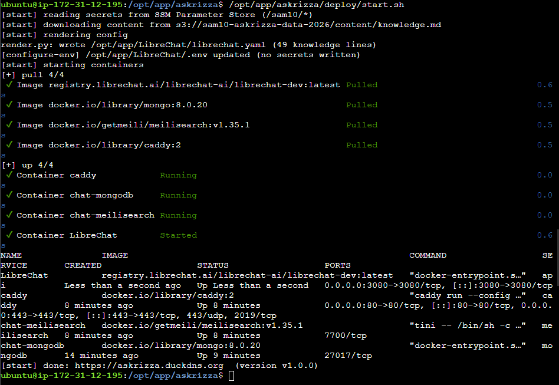
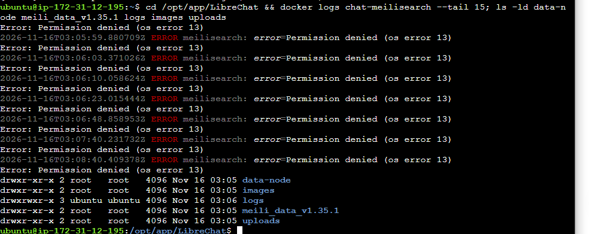
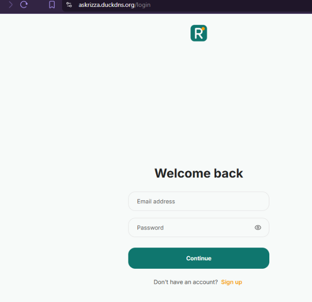
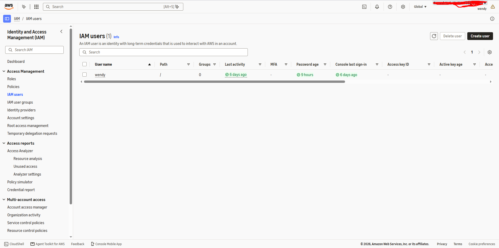

This page records the system **before I hardened and operated it**, as first deployed on **16 Nov 2026** (around 03:05 UTC).

## Environment before

| Area | State at first deploy |
|---|---|
| Application | Stock LibreChat with its default `docker-compose.yml`: **6 containers** (LibreChat, MongoDB, Meilisearch, pgvector, rag_api, Caddy) |
| Health | **2 of 6 containers crash-looping**: Meilisearch (`Permission denied (os error 13)`) and rag_api (`Missing credentials… OPENAI_API_KEY`) |
| Secrets | LibreChat generates temporary secrets into `.env.temp` on the server's disk when none are set |
| Access | **Public registration open**: anyone could create an account and use the AI quota |
| Monitoring | None. No dashboard, no alarms, no request logs leaving the server. |
| Backups | None. MongoDB data lived only on the instance's disk. |
| Automation | None |
| Cost | The account had already spent **$25.61 month-to-date** (forecast **$61.94**) on other workloads before AskRizza existed |

## Account security before

| Item | Before |
|---|---|
| MFA on my IAM user | **Not set** |
| CloudTrail trail | None for this project |
| EBS default encryption | Off |
| Budget alert | None |

