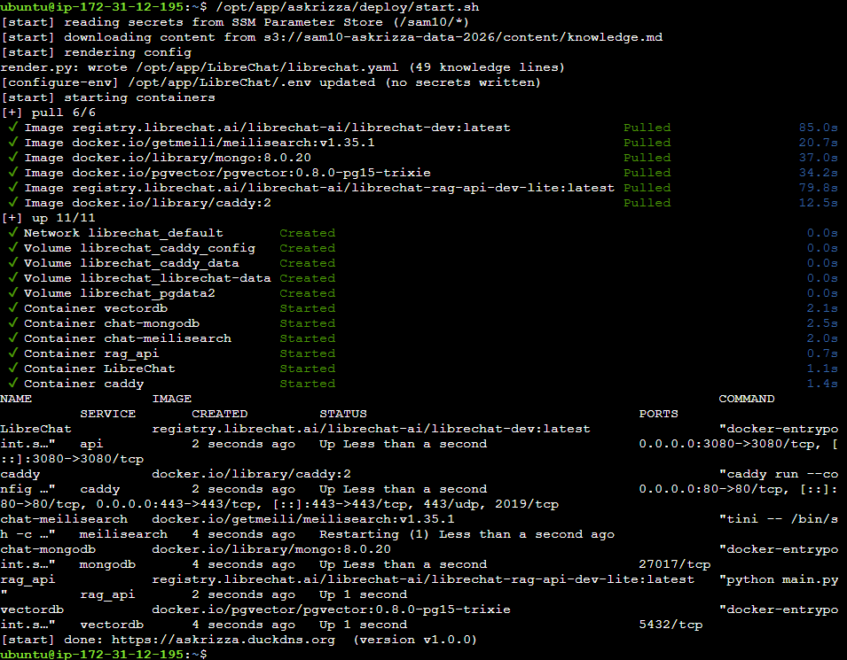
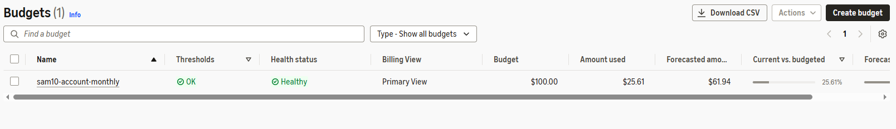

## What I started with

The first deployment was stock LibreChat with its default `docker-compose.yml`: six containers on one server, reachable over HTTPS. It worked, in the sense that the page loaded. It wasn't something anyone should rely on.

| Area | At first deploy | Why it mattered | Now |
|---|---|---|---|
| Container health | 2 of 6 crash-looping Meilisearch ("Permission denied") and rag_api ("Missing credentials… OPENAI_API_KEY") | Chat search was broken, and MongoDB had the same permission fault waiting to happen | 4 of 4 healthy |
| Secrets | Auto-generated into a file LibreChat writes temporary keys to `.env.temp` on the disk when none are set | Anyone with the disk or a copy of it has the keys | In Parameter Store |
| Sign-up | Open to anyone | Strangers could create accounts and use up the AI quota | Closed |
| Monitoring | None no dashboard, no alarms, no logs leaving the server | A failure would only be noticed when a student complained | Dashboard and 7 alarms |
| Backups | None MongoDB only on the server's disk | Losing the disk would mean losing every account and chat | Hourly to S3, restore tested |
| Automation | None | Every check depended on me remembering to do it | 2 running unattended |

#### First deploy

#### After the fixes

#### Sign-up open

#### Sign-up closed

## The account, before

| Item | Before | Now |
|---|---|---|
| MFA on my IAM user | Not set | Virtual MFA |
| CloudTrail trail | None for this project | `sam10-trail`, logging |
| EBS default encryption | Off | On |
| Budget alert | None | Monthly budget with email alerts |

## Cost before

AskRizza runs in a shared course account, which already had spending before AskRizza existed: **$25.61 month to date** on 16 Nov, with a forecast of $61.94 for November. That's my "before" figure for the [cost comparison](results.html#cost).

