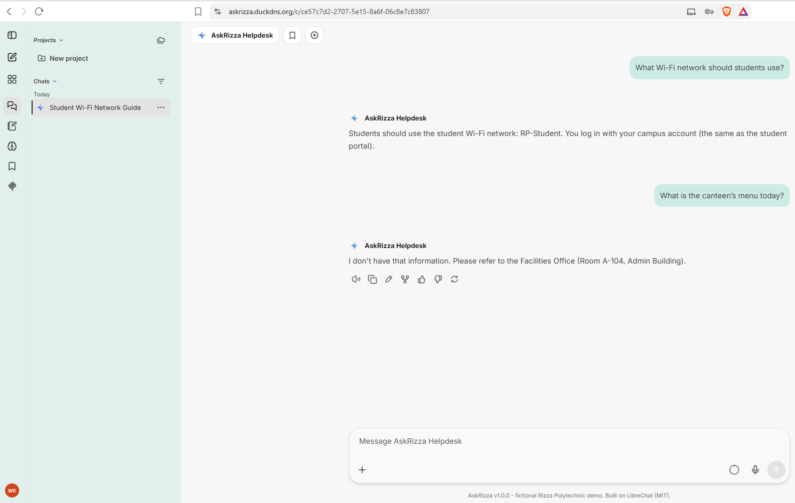

> ✏️ **DRAFT.** Rewrite every page in your own words before submitting, and delete these ✏️ notes.

<!-- ✏️ Replace VIDEO_ID with your YouTube video's ID (the part after watch?v=) -->

<iframe src="https://www.youtube.com/embed/VIDEO_ID" title="AskRizza presentation"
 style="position:absolute;top:0;left:0;width:100%;height:100%;border:0" allowfullscreen></iframe>

## What the system does

**AskRizza** is a helpdesk chatbot for **Rizza Polytechnic, a fictional college**. Students can ask practical questions about campus facilities, such as building hours, room bookings, Wi-Fi, parking, lockers and lost & found. It answers only from a set of invented campus facts. When it doesn't know an answer, it says so and points the user to the Facilities Office. It never makes decisions about individual people.

It is built on **LibreChat**, an open-source ChatGPT-style application (MIT licence). LibreChat was reskinned with a new name, logo, colours, wording and content. It runs on **one AWS server** at <https://askrizza.duckdns.org> and sends questions to **Google Gemini**, an AI model hosted outside AWS.

## What was wrong with how it was run

The first deployment of the stock application ([baseline](baseline.html)) worked, but it wasn't safe to rely on:

- **2 of its 6 containers were crash-looping.** The search engine couldn't write to its data folder, and the document-search service needed a paid OpenAI key.
- **Secrets** were auto-generated into a file on the server.
- **Anyone on the internet could register** and use the AI quota.
- **No monitoring, alerts or backups existed.** A failure would only have been noticed by a user, and lost data couldn't have been recovered.

## What changed

| Area | Now |
|---|---|
| Monitoring | CloudWatch dashboard, **7 alarms** emailing the operator. A real outage was detected in **1 min 37 s**. |
| Backups | MongoDB dumped to versioned S3 **every hour**. A full restore was tested: **about 40 s** from data loss to service back. |
| Security | MFA, least-privilege IAM roles, **all secrets in SSM Parameter Store**, no SSH port, registration closed, CloudTrail, encrypted disk |
| Automation | Hourly backup (cron) and an external health and answer check every 15 min (EventBridge + Lambda) |
| Reliability | Data-folder ownership fault found, fixed and prevented. Unused services removed, so **4/4 containers are healthy**. |

## What improved

See [Results](results.html) for before-and-after numbers.

## Pages

1. [AWS infrastructure design](infrastructure.html)
2. [The system and its system card](system.html)
3. [Baseline](baseline.html)
4. [Well-Architected review](well-architected.html)
5. [Monitoring, backup & restore, security](operations.html)
6. [Automation and incident](automation-incident.html)
7. [Results](results.html)
8. [What I would do next](next-steps.html)
9. [Declaration](declaration.html)
