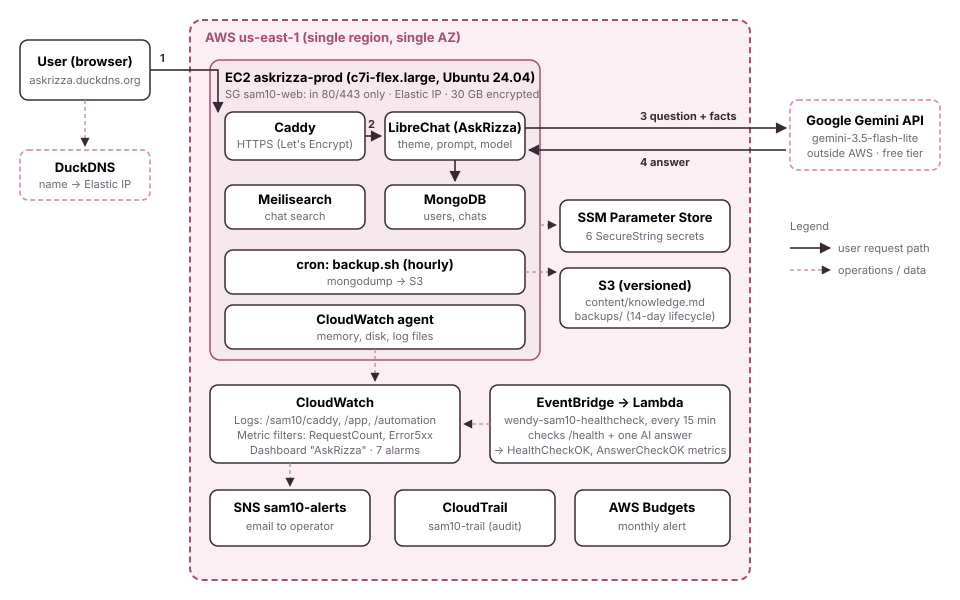
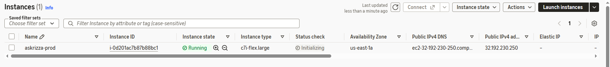

## The map

<figure class="full">
  
  <figcaption>Solid arrows are a student's question. Dashed lines are operations: secrets, content, backups, metrics and alerts. Dashed boxes are outside AWS.</figcaption>
</figure>

## How a student's question travels

<ol class="steps">
  <li><strong>A student opens AskRizza</strong> at <code>askrizza.duckdns.org</code>. DuckDNS, a free DNS service, points that name at the server's fixed Elastic IP address.</li>
  <li><strong>The request reaches the AWS server over HTTPS.</strong> Only ports 443 and 80 are open. Caddy answers, using a free Let's Encrypt certificate that it renews by itself, and writes one log line per request.</li>
  <li><strong>Caddy forwards it to LibreChat</strong>, the chat application, on the server's private Docker network.</li>
  <li><strong>LibreChat loads the conversation and the campus instructions.</strong> The chat history comes from MongoDB. The instructions are AskRizza's system prompt, which contains the campus facts copied from S3 when I last deployed.</li>
  <li class="external"><strong>The question and those facts go to Google Gemini</strong> (<code>gemini-3.5-flash-lite</code>), an external AI service on Google's servers, not on mine. The key for it is read from Parameter Store, never from a file.</li>
  <li><strong>The answer streams back</strong> through LibreChat and Caddy to the student, and the conversation is saved in MongoDB.</li>
</ol>

What AskRizza doesn't use
There is no document search or retrieval pipeline (RAG). LibreChat's RAG services are switched off, and all the facts fit inside the system prompt. AskRizza doesn't run or train its own model either.

## Every service and why it's there

| Service | My resource | What it does for AskRizza |
|---|---|---|
| **EC2** | `askrizza-prod`, c7i-flex.large, Ubuntu 24.04, 30 GB encrypted disk, Elastic IP | The one server. Runs everything below in Docker containers. |
| **Docker** containers | Caddy, LibreChat, MongoDB, Meilisearch | Caddy for HTTPS, LibreChat for chat, MongoDB for accounts and conversations, Meilisearch for searching old chats |
| **VPC security group** | `sam10-web` | Lets in only TCP 443 and 80. There's no SSH port; I manage the server through Systems Manager Session Manager. |
| **Systems Manager** | Parameter Store `/sam10/*`, Session Manager | Holds the 6 secrets as encrypted SecureStrings, and gives me a terminal without opening a port |
| **S3** | `sam10-askrizza-data-2026`: private, versioned, encrypted | `content/knowledge.md`, the campus facts, and `backups/mongo/`, the hourly database dumps (kept 14 days) |
| **CloudWatch** | Logs, 2 metric filters, the `AskRizza` dashboard, 7 alarms | Request logs, server metrics, and alerts |
| **EventBridge → Lambda** | `wendy-sam10-healthcheck`, every 15 minutes | Checks the site from outside and asks the AI one test question |
| **SNS** | `sam10-alerts` | Emails me alarms and failed backups |
| **CloudTrail** | `sam10-trail` | A record of who changed what in the account |
| **Budgets** | `sam10-account-monthly` | A cost alert for the account |
| **IAM** | `sam10-ec2-role`, the health-check role, my user `wendy` with MFA | Each part gets only the permissions it needs |
| Outside AWS | Google Gemini API (free tier), DuckDNS | The AI model, and the free domain name |

## How it's deployed

One script, `deploy/start.sh`, rebuilds the whole configuration every time:
1. it reads the 6 secrets from Parameter Store, straight into memory and never onto disk
2. it downloads the campus facts from S3 and writes them into the system prompt
3. it applies my non-secret settings and starts the containers
4. it restarts the app, so every change takes effect

A brand-new server is set up with `deploy/bootstrap.sh`. Both are in the [repository]({{ site.repo_url }}).

