## Monitoring

### The dashboard

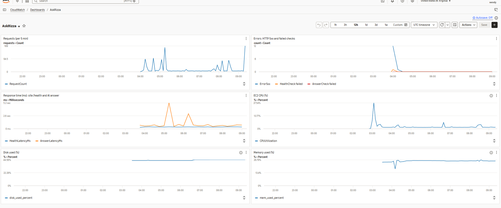

What the 12 hours to 16 Nov 2026 09:30 UTC show (monitoring started at about 03:00):
- **Errors:** one spike at about 04:10, my deliberate outage test. HTTP 5xx rose to 12 and one health check failed. Zero after that.
- **CPU:** a peak of about 27% at about 03:10 while the containers were first downloaded, then about 1–2%.
- **Memory** steady at about 27%, **disk** at about 45%.
- **Response time:** `/health` about 0.35 s. AI answers usually 0.5–1 s, with occasional slow ones up to about 5 s.
- **Requests:** the spikes are my own testing.

| Widget | Where the number comes from |
|---|---|
| Requests per 5 min | Metric filter `RequestCount` on the Caddy access log |
| Errors | HTTP 5xx (metric filter `Error5xx`), plus failed health and answer checks |
| Response time | `HealthLatencyMs` (site) and `AnswerLatencyMs` (AI), measured by the health-check Lambda |
| CPU | `AWS/EC2 CPUUtilization` |
| Disk used | CloudWatch agent `disk_used_percent` for `/` |
| Memory used | CloudWatch agent `mem_used_percent` |

### Seven alarms

All 7 email me through the SNS topic `sam10-alerts`, both when they go off and when they recover.

| Alarm | Fires when | Why I chose this threshold |
|---|---|---|
| `askrizza-cpu-high` | CPU > 85% for 10 min | A short spike is normal while answering. Ten minutes high means something is stuck or looping. |
| `askrizza-status-check-failed` | Any EC2 status check fails | It means the machine itself is unhealthy. |
| `askrizza-disk-high` | Disk > 85% | Leaves room to clean up before MongoDB fails writes at 100%. |
| `askrizza-memory-high` | Memory > 90% for 5 min | Above this, Linux starts killing containers. |
| `askrizza-http-5xx` | Any HTTP 5xx in 5 min | A helpdesk should never return server errors. |
| `askrizza-site-down` | The `/health` check fails twice in a row | One failure could be a network blip. Two in a row is an outage. |
| `askrizza-answers-wrong` | The AI answer check fails twice in a row | The site can be up but useless if the model or its key breaks. |

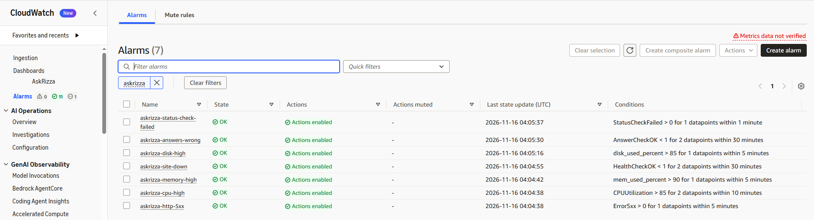

### Proof an alert reaches a person
<span class="tag tag-drill">Simulated failure</span> On 16 Nov 2026 I stopped the app on purpose with `docker stop LibreChat`, to check that an alert would really reach me.

<ol class="timeline">
  <li><time>04:10:01 UTC</time><strong>Fault started</strong><span>App container stopped. Students now get HTTP 502.</span></li>
  <li class="key"><time>04:11:38 UTC</time><strong>Alarm and email</strong><span><code>askrizza-http-5xx</code> went into ALARM and SNS emailed me.</span></li>
  <li><time>04:14:54 UTC</time><strong>Restored</strong><span><code>docker start LibreChat</code>. The OK email followed.</span></li>
</ol>

**Time to detect: 1 min 37 s.** **Time to restore: 4 min 53 s.**

<div class="split">
<div markdown="1">
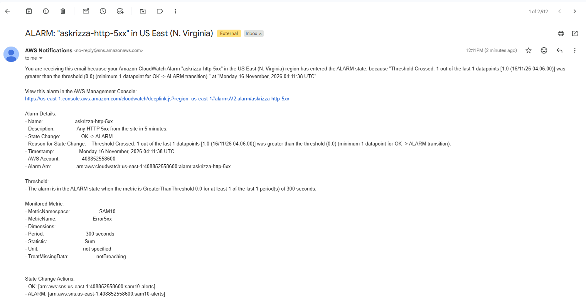
</div>
<div markdown="1">
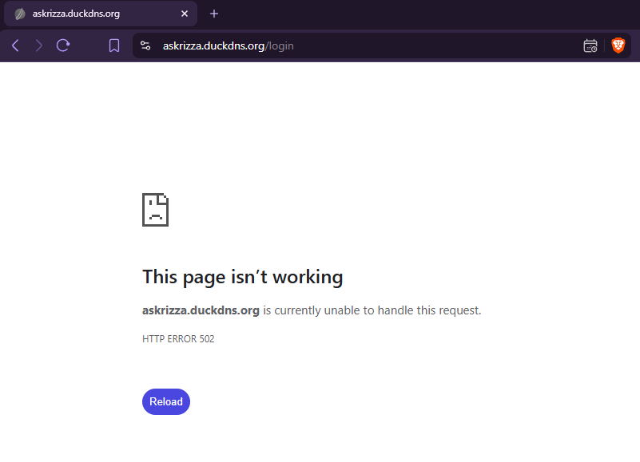
</div>
</div>

<details class="more">
<summary>The stop and start commands</summary>
<div class="more-body" markdown="1">
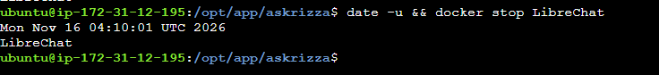
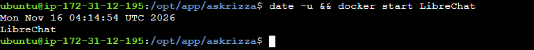
</div>
</details>

### Request logs
Caddy writes one JSON line per request to CloudWatch Logs `/sam10/caddy`: time, method, URL, status, duration, and an `X-App-Version` header showing which version answered. LibreChat's own logs go to `/sam10/app`. For its test question, the health-check Lambda logs the question, how long the answer took and whether it was right. Every log group has a retention period, none "Never expire": 2 weeks for request and app logs, 1 month for automation and Lambda logs.

```json
{
  "msg": "handled request",
  "request": { "method": "GET", "host": "askrizza.duckdns.org", "uri": "/health",
               "headers": { "User-Agent": ["Python-urllib/3.12"] } },
  "duration": 0.002015087,
  "status": 200,
  "resp_headers": { "X-App-Version": ["v1.0.0"] }
}
```
<p style="font-size:.85rem;color:var(--gray)">One request from <code>/sam10/caddy</code>, the health check at 09:29:23 UTC on 16 Nov, trimmed.</p>

<details class="more">
<summary>Log screenshots</summary>
<div class="more-body" markdown="1">
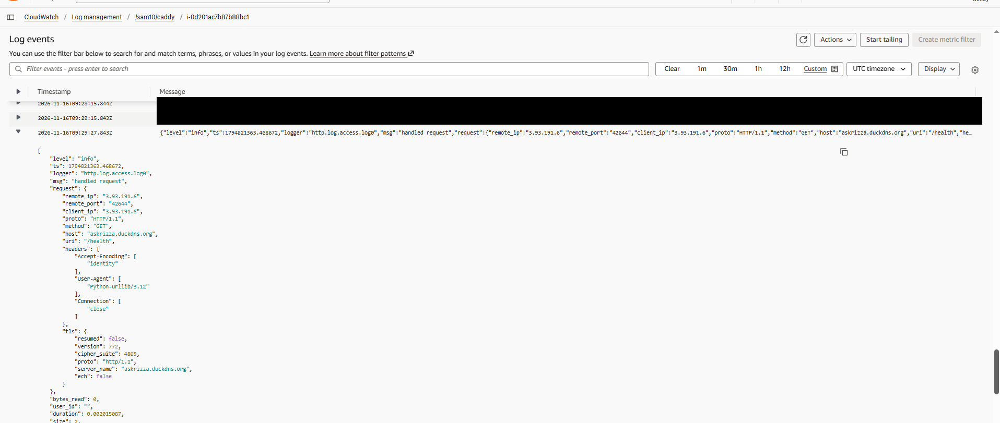
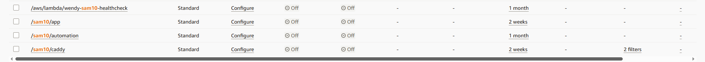
</div>
</details>

## Backup and restore

### What would need restoring

| Item | Where it lives | How it's protected |
|---|---|---|
| MongoDB: user accounts and every conversation | The server's disk | `mongodump` to S3 **every hour**, kept 14 days |
| Campus facts, `knowledge.md` | S3 `content/` | S3 versioning (old versions kept 30 days), plus a copy in git |
| 6 secrets | Parameter Store | Managed by AWS, never on the server's disk |
| Configuration and code | GitHub | Git history |
| HTTPS certificate | Caddy's volume | Not backed up. Caddy issues a new one by itself. |
| Chat search index | The server's disk | Not backed up. Meilisearch rebuilds it from MongoDB. |

### The restore test
On 16 Nov 2026 I deliberately lost the database and brought it back from S3.

<ol class="timeline">
  <li><time>04:20:03 UTC</time><strong>Backup taken</strong><span>After creating a chat called "Restore test 1".</span></li>
  <li><time>04:20:42 UTC</time><strong>Database lost</strong><span>Stopped the app, moved MongoDB's data folder away, and started an empty MongoDB: 0 users.</span></li>
  <li><time>04:21:13 UTC</time><strong>Restore started</strong><span><code>scripts/restore.sh</code> downloaded the newest dump from S3.</span></li>
  <li class="key"><time>04:21:22 UTC</time><strong>Service back</strong><span>74 documents restored, 0 failed (1 user, 2 conversations, 6 messages) in 9 s. I logged in and the "Restore test 1" chat was there.</span></li>
</ol>

<div class="callout">
<span class="callout-label">RPO and RTO</span>
<strong>RPO:</strong> at most one hour of chats could be lost, because the database is backed up every hour.<br>
<strong>RTO:</strong> the measured restore took about 40 seconds from loss to service back (9 s for the restore itself). Allowing for someone to notice and follow the runbook, I'd expect about 10 minutes.
</div>

<div class="compare">
<div class="compare-col before" markdown="1">
#### Database emptied
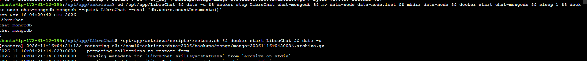
</div>
<div class="compare-col after" markdown="1">
#### Restored from S3

</div>
</div>

<details class="more">
<summary>The test chat before and after, and a backup run</summary>
<div class="more-body" markdown="1">
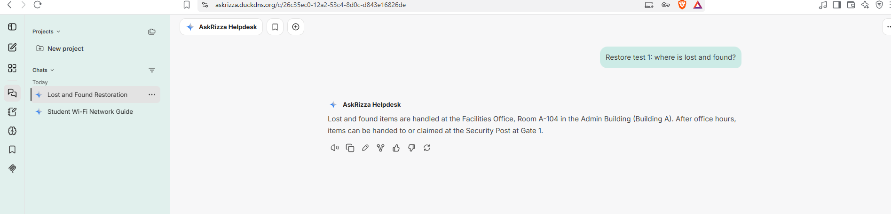
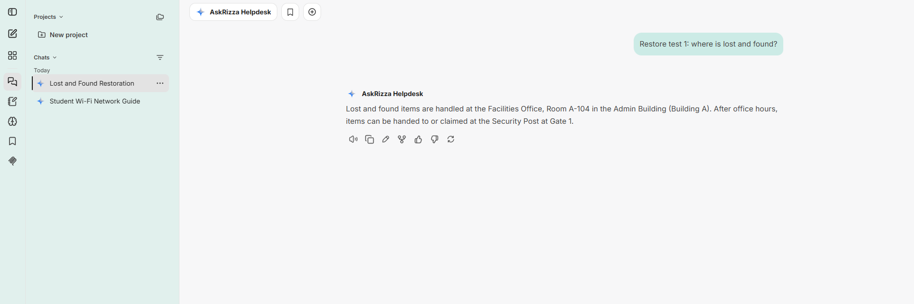
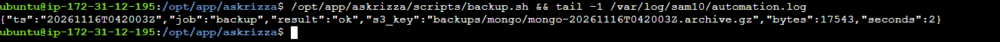
</div>
</details>

## Security

| Control | Before | Now | The risk it addresses |
|---|---|---|---|
| MFA on my IAM user | Off | **On (virtual MFA)** | A stolen password alone isn't enough to get in. |
| Personal login, no shared admin | My own IAM user `wendy` | Same. The root user belongs to my instructor, who owns the account; I have no access to it. | Every action traces back to one person. |
| Secrets | Generated into a file on the disk | **6 Parameter Store SecureStrings**, read at deploy time. None in code, config files or git history. | A leaked repository or disk exposes no keys. |
| Least privilege | – | The server's role can read only `/sam10/*` parameters, use one bucket and publish to one topic. The Lambda can only write metrics to `SAM10` and read one parameter. | A compromised server or function can't reach anything else. |
| Network | – | Only 443 and 80 open. **No SSH**: Session Manager only. MongoDB is never exposed. | No password-guessing on SSH, and no database open to the internet |
| Sign-up | **Open to anyone** | **Closed** | Strangers can't create accounts or use the AI quota. |
| Personal data | – | All content invented. The system prompt forbids asking for personal details. `scripts/pii-check.sh` scans every message students typed for emails and phone numbers. On 16 Nov 08:29 UTC it scanned 14 messages: **clean**. | Nothing personal leaves the account for Google. |
| Audit trail | None | **CloudTrail** `sam10-trail`, all regions | I can see who changed what, and when. |
| Encryption at rest | Off by default | **EBS default encryption on**, S3 encryption on | A copied disk or backup is unreadable. |
| Threat detection | – | GuardDuty **isn't available** on this account's Free plan | A known gap |

**Secret scan:** on 16 Nov 09:54 UTC I ran [gitleaks](https://github.com/gitleaks/gitleaks) over the full history of my repository: **12 commits scanned, no leaks found.**

<details class="more">
<summary>Security evidence (10 screenshots)</summary>
<div class="more-body" markdown="1">
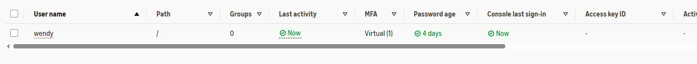


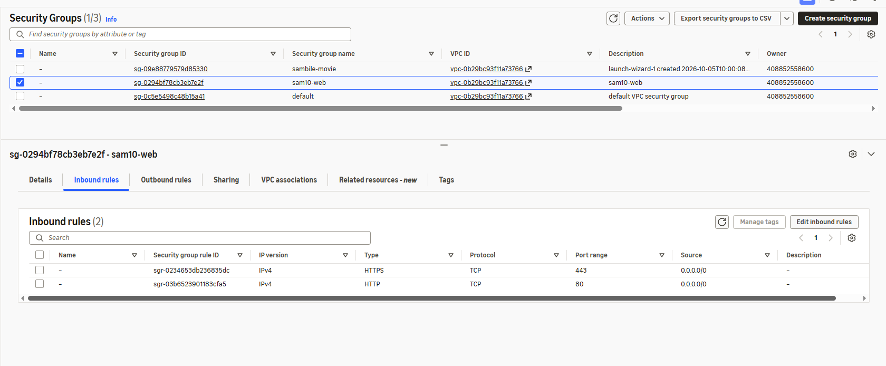
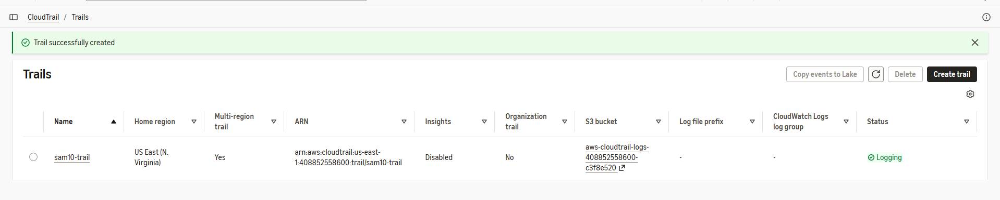
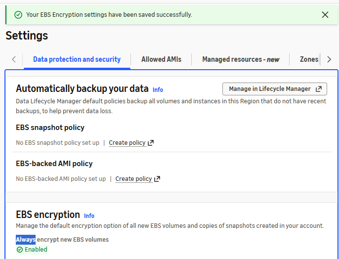
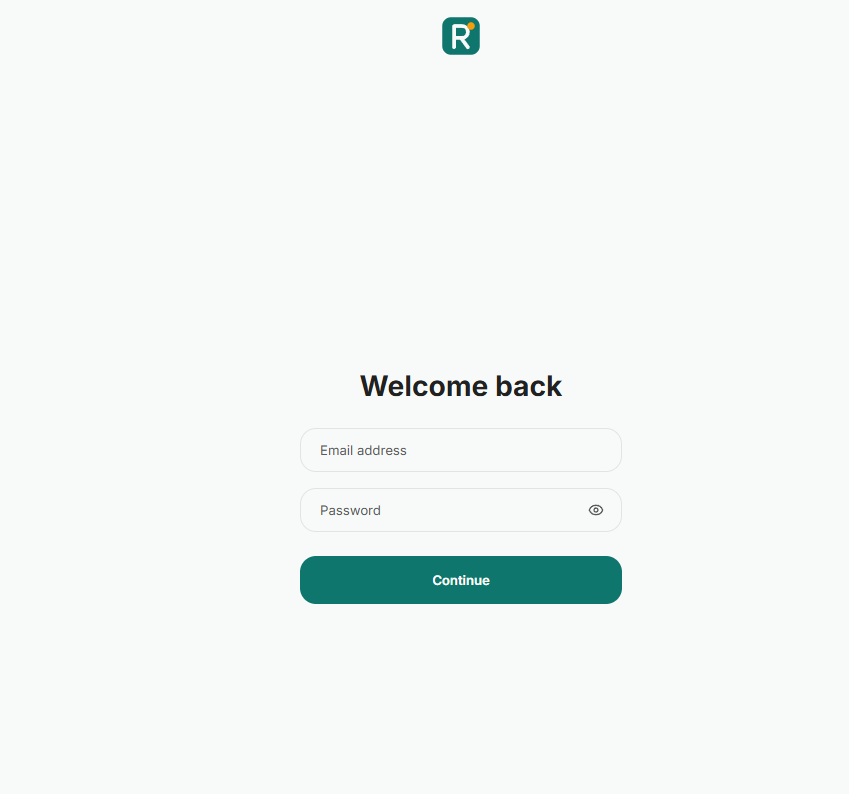

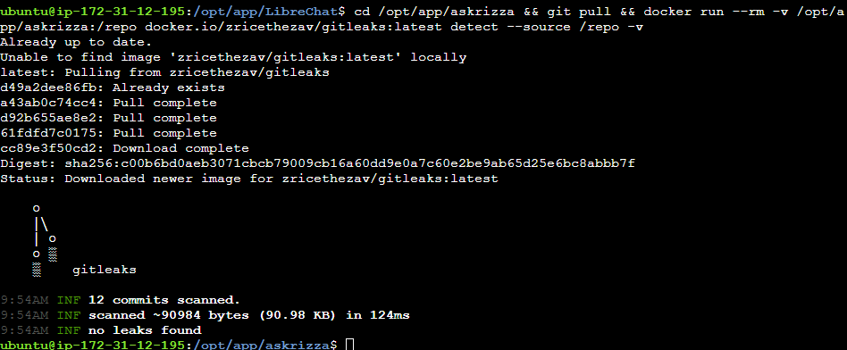
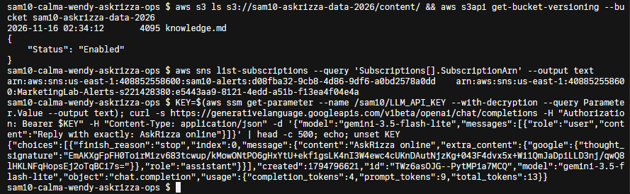
</div>
</details>
