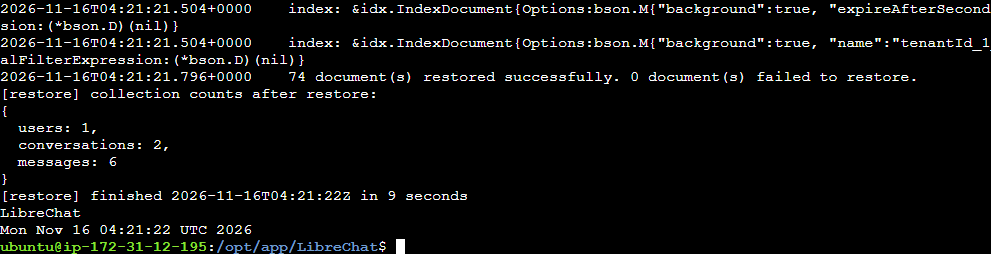
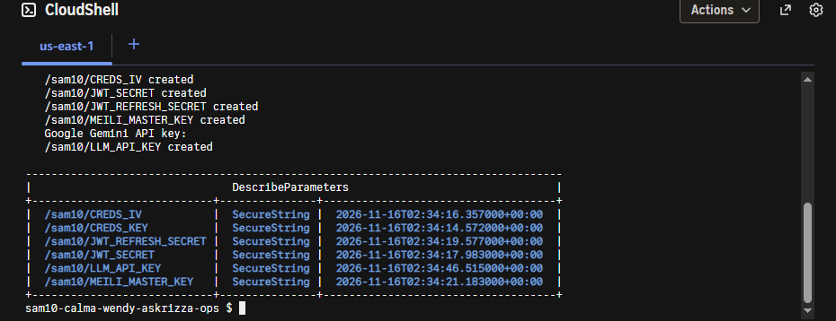
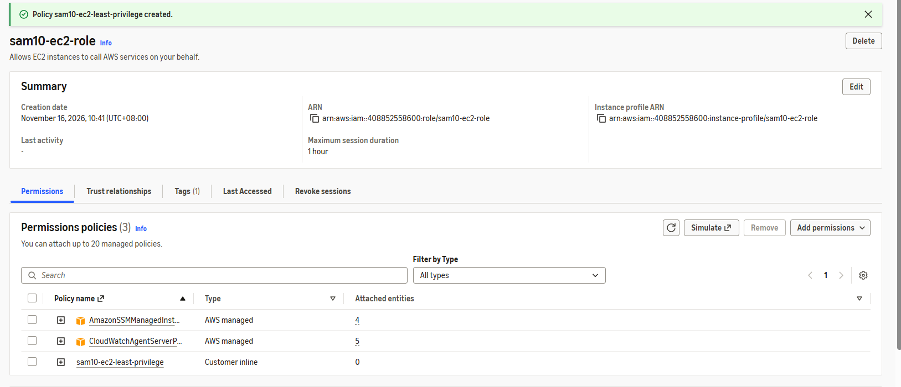
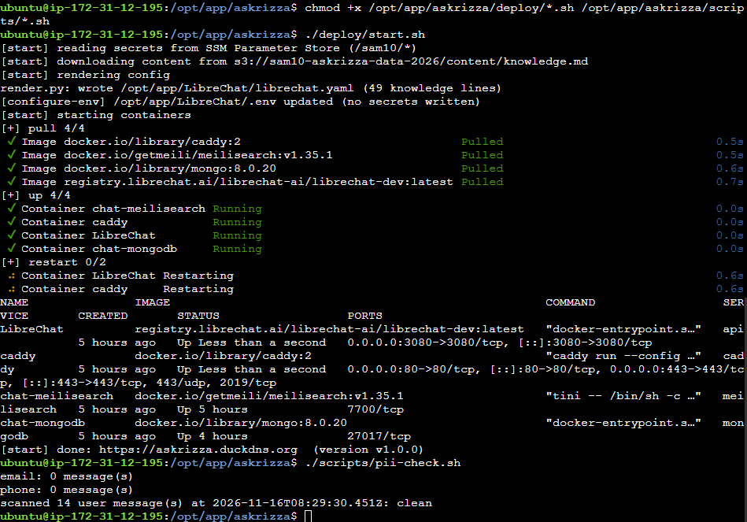

# Monitoring

## Dashboard
✏️ *Insert a screenshot of the populated **AskRizza** dashboard (CloudWatch → Dashboards → AskRizza), E-06.*

| Widget | Source |
|---|---|
| Requests per 5 min | Metric filter `RequestCount` on the Caddy access log |
| Errors | HTTP 5xx (metric filter `Error5xx`), plus failed health and answer checks |
| Response time | `HealthLatencyMs` (site) and `AnswerLatencyMs` (AI), measured by the Lambda |
| CPU | `AWS/EC2 CPUUtilization` |
| Disk used | CloudWatch agent `disk_used_percent` for `/` |
| Memory used | CloudWatch agent `mem_used_percent` |

## Alarms
All 7 alarms email the operator through SNS topic `sam10-alerts`, on both ALARM and OK.

| Alarm | Condition | Why this threshold |
|---|---|---|
| askrizza-cpu-high | CPU > 85% for 10 min | A short spike is normal while answering. Ten minutes high means a stuck process or a loop. |
| askrizza-status-check-failed | StatusCheckFailed > 0 for 1 min | Any failed EC2 status check means the machine itself is unhealthy. |
| askrizza-disk-high | Disk > 85% | Leaves room to clean up before MongoDB fails writes at 100%. |
| askrizza-memory-high | Memory > 90% for 5 min | Above this, Linux starts killing containers. |
| askrizza-http-5xx | Any HTTP 5xx in 5 min | A helpdesk site should never return server errors. |
| askrizza-site-down | /health check fails twice in a row (30 min) | One failed check could be a network blip. Two in a row is a real outage. |
| askrizza-answers-wrong | AI answer check fails twice in a row | The site can be "up" but useless if the model or key breaks. This catches that. |

## Proof an alert reached a real person
On 16 Nov 2026 I stopped the application container on purpose (`docker stop LibreChat`) to test the alerting.

| Event | Time (UTC) |
|---|---|
| Fault started | 04:10:01 |
| Users see HTTP 502 | from 04:10 |
| `askrizza-http-5xx` → ALARM, email received | **04:11:38** |
| Service restored (`docker start LibreChat`) | 04:14:54 |

**Time to detect: 1 min 37 s.** **Time to restore: 4 min 53 s.**

## Request log
Caddy writes one JSON line per request (time, method, URI, **status**, **duration**, and the `X-App-Version` header showing which version answered) to CloudWatch Logs `/sam10/caddy` (14-day retention). LibreChat's own logs go to `/sam10/app`.

The health-check Lambda logs the **question asked, how long it took and whether it succeeded** for its test question in `/aws/lambda/wendy-sam10-healthcheck`.

Every log group has a retention period (none set to "Never expire"): 2 weeks for request and app logs, 1 month for automation and Lambda logs.

✏️ *Insert a screenshot of a few lines from `/sam10/caddy` in CloudWatch Logs (E-09).*

---

# Backup and restore

## What would have to be restored

| Item | Where it lives | Protection |
|---|---|---|
| MongoDB (user accounts, all conversations) | EC2 disk, `/opt/app/LibreChat/data-node` | `mongodump` to S3 **every hour**, kept 14 days |
| Assistant content (`knowledge.md`) | S3 `content/` | S3 **versioning** (old versions kept 30 days), plus a copy in git |
| Secrets (6) | SSM Parameter Store | Managed by AWS, not on the server |
| Configuration and code | GitHub repository | Git history |
| HTTPS certificate | Caddy volume | Not backed up; Caddy re-issues it automatically |
| Meilisearch index | EC2 disk | Not backed up; rebuilt from MongoDB |

## Restore test (16 Nov 2026)
1. Created a chat "Restore test 1" and took a backup (04:20:03 UTC).
2. **Simulated losing the database:** stopped the app, moved the data folder away and started an empty MongoDB, which showed **0 users** (04:20:42).
3. Ran `scripts/restore.sh`: downloaded the newest dump from S3 and restored **74 documents, 0 failed** (1 user, 2 conversations, 6 messages) in **9 s**.
4. Started the app (04:21:22), logged in, and the "Restore test 1" chat was back.

**RPO:** at most 1 hour of chats could be lost, because the database is dumped to S3 every hour.
**RTO:** the measured restore took about 40 seconds from data loss to service back (9 s for the restore itself), so about 10 minutes including someone noticing and following the runbook.

---

# Security

| Control | Before | After | Risk it addresses |
|---|---|---|---|
| MFA on IAM user | Off | **On (virtual)** | A stolen password alone can't access the account. |
| Personal IAM user, no root | Root not used | Own IAM user `wendy`. Root is the instructor's, ✏️ *MFA confirmed by instructor?* | Every action is traceable to one person. |
| Secrets | Generated into a file on disk | **6 SSM SecureStrings**, read at deploy time. None in code, config files or git history. | A leaked repository or disk image exposes no keys. |
| Least privilege | n/a | EC2 role: only `/sam10/*` parameters, one bucket, one SNS topic. Lambda: only PutMetricData (namespace SAM10) and one parameter. | A compromised server or function can't touch anything else. |
| Network | n/a | Only 80/443 open. **No SSH**: Session Manager only. MongoDB is never exposed. | No password-guessing on SSH. The database isn't reachable from the internet. |
| Registration | **Open to anyone** | **Closed** | Strangers can't create accounts and use the AI quota. |
| Personal data | n/a | All content invented. The system prompt forbids asking for personal data. `scripts/pii-check.sh` scans every user message in MongoDB for emails and phone numbers Result on 16 Nov 2026 08:29 UTC: **14 user messages scanned, 0 emails, 0 phone numbers: clean.**. | Nothing personal leaves the account for Google. |
| Audit trail | None | **CloudTrail** `sam10-trail`, multi-region | We can see who changed what, and when. |
| Encryption at rest | Default off | **EBS default encryption on**. S3 SSE on. | Disks and backups are unreadable if copied. |
| Threat detection | n/a | GuardDuty **not available** on the Free account plan (documented gap) | n/a |

✏️ *Add: a screenshot of the `sam10-web` security group inbound rules (80 and 443 only).*

✏️ *Add: the output of a secret scan of the repository, e.g. `gitleaks detect`, showing no leaks.*
