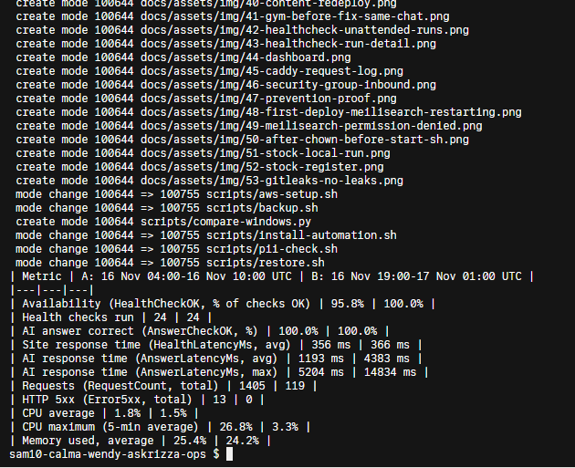
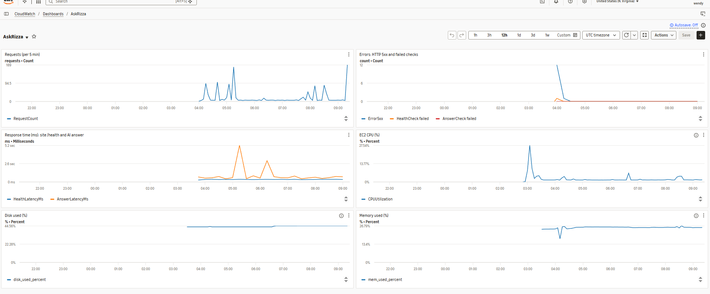
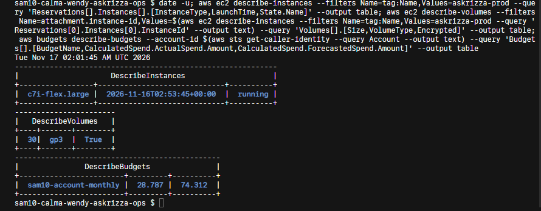

## Before and after

| What I measured | Before: first deploy, 16 Nov ~03:06 UTC | After: 16–17 Nov 2026 | How I measured it |
|---|---|---|---|
| Healthy containers | 4 of 6 (2 crash-looping) | **4 of 4**, after switching off two unused services | `docker compose ps` |
| Alarms | 0 | **7** | CloudWatch → Alarms |
| Time to detect an outage | unknown: nothing was watching | **1 min 37 s** | Outage drill, 16 Nov 04:10 UTC |
| Backups and RPO | none, so a lost disk loses everything | **hourly**, at most 1 hour of chats lost | The backup log |
| Restore and RTO | never tested | **about 40 s**, tested | Restore test, 16 Nov 04:20 UTC |
| Secrets on disk or in the repository | generated into `.env.temp` | **0**, all 6 in Parameter Store | `.env` checked, gitleaks scan |
| Open inbound ports | – | 443 and 80 only, no SSH | Security group |
| Public sign-up | open | **closed** | The login page |
| Answer quality | not measured | **13 of 14** on the first evaluation; the one miss fixed by a content change | 14 test questions, plus the Lambda's check every 15 min |

## Two equal windows

To compare fairly, I measured the same things the same way over two **6-hour** windows, using `scripts/compare-windows.py`, which reads the numbers straight from CloudWatch:
- **Window A, the first day:** the outage drill, the restore test, the content fix and my own testing all happened here.
- **Window B, steady state:** overnight, with no changes and nobody touching it.

| Metric | **A:** 16 Nov 04:00–10:00 UTC | **B:** 16 Nov 19:00 – 17 Nov 01:00 UTC |
|---|---|---|
| Availability (health checks passed) | 95.8% (23 of 24) | **100%** (24 of 24) |
| AI answer check correct | 100% | 100% |
| Site response time, `/health`, average | 356 ms | 366 ms |
| AI response time, average | 1,193 ms | **4,383 ms** |
| AI response time, slowest | 5,204 ms | **14,834 ms** |
| Requests | 1,405 | 119 |
| HTTP 5xx | 13 | **0** |
| CPU, average / slowest 5 minutes | 1.8% / 26.8% | 1.5% / 3.3% |
| Memory used, average | 25.4% | 24.2% |

0

Failures I didn't cause myself

The one failed health check and all 13 HTTP 5xx in window A are the outage drill at 04:10. Left alone in window B, AskRizza was 100% available with no errors.

~0.36 s

The server answers quickly either way

Site response time is almost identical in both windows, and CPU and memory stay low. The server isn't the bottleneck; if anything it's oversized (see <a href="well-architected.html#performance-efficiency">Performance Efficiency</a>).

~4×

Slower AI answers overnight

Gemini averaged 4.4 s (up to 14.8 s) in window B against 1.2 s in window A, while my server sat idle. Window B is daytime in the US, so this is most likely load on Google's free tier. My monitoring catches a wrong answer but not a slow one. An alarm on <code>AnswerLatencyMs</code> (say, average above 8 s for 30 minutes) is the next one I'd add.

The comparison as the script printed it

## Cost

IAM users can't see billing on this account: Cost Explorer and cost allocation tags both say "IAM user access not activated", and only the root user can change that. So I **calculated** AskRizza's cost from its real running hours (from `describe-instances` and `describe-volumes`) multiplied by AWS's published us-east-1 prices. Only the Budgets totals come straight from AWS.

| Resource | Usage: 16 Nov 02:53:45 → 17 Nov 02:01:45 UTC (23.1 h) | Price | Cost |
|---|---|---|---|
| EC2 c7i-flex.large | 23.1 h | $0.08479 per hour | $1.96 |
| Public IPv4 (Elastic IP) | 23.1 h | $0.005 per hour | $0.12 |
| EBS gp3, 30 GB | 23.1 h | $0.08 per GB-month | $0.08 |
| S3, Lambda, SNS, Parameter Store | ~20 KB of backup per hour, 96 Lambda runs a day | free tier, or fractions of a cent | ≈ $0.00 |
| CloudWatch: 8 custom metrics, 7 alarms, 1 dashboard, logs | | free tier if the account has room; at most ≈ $0.20 a day | $0.00–0.20 |
| Gemini API | free tier | | $0.00 |
| **Total for the first 23 hours** | | | **≈ $2.15–2.35** |

| | Amount | Source |
|---|---|---|
| Account spend this month, **before** AskRizza (16 Nov) | $25.61 (forecast $61.94) | AWS Budgets |
| Account spend this month, **after** one day (17 Nov 02:01 UTC) | $28.79 (forecast $74.31) | AWS Budgets, `describe-budgets` |
| Difference | +$3.18 | AskRizza (≈ $2.2) plus other people's resources on this shared account |
| AskRizza if left running for a month | **≈ $68** | Calculated, almost all of it the server |

What the cost tells me
91% of the cost is the server, and the dashboard shows it running at about 2% CPU. A 2 GiB instance would cut the monthly bill to roughly a third. Shutting everything down after grading takes it to $0.

The usage figures behind the calculation

