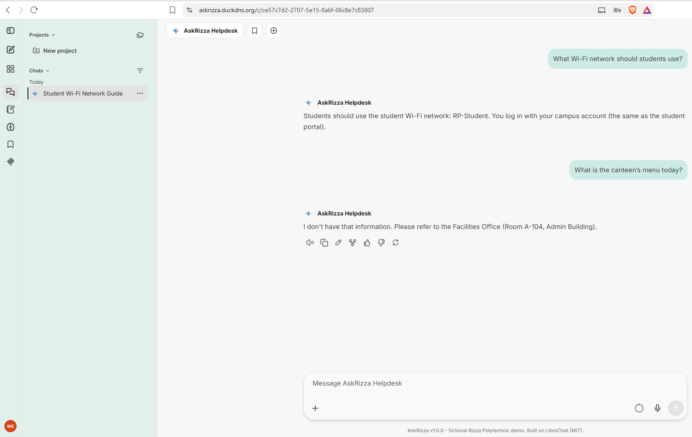

## Original vs. reskin

| Original LibreChat | AskRizza |
|---|---|
| ✏️ *Insert your local stock LibreChat screenshot (E-05) here:* `assets/img/00-stock-librechat.png` |  |

## Test questions

✏️ Run all 10 in a **new chat** and fill in the Result column. The first three are the required "three test questions", including one failure.

| # | Question | Expected (from `knowledge.md`) | Result |
|---|---|---|---|
| 1 | What Wi-Fi network should students use? | RP-Student, campus account login | ✅ Correct |
| 2 | Where is lost and found? | Facilities Office A-104; after hours, Security Post at Gate 1 | ✅ Correct |
| 3 | What is the canteen's menu today? | Not in the facts, so it should say it doesn't know | ✅ Correctly refused |
| 4 | What time does the library close on Saturday? | 17:00 | |
| 5 | How far in advance must I book the auditorium? | 10 working days, written request to Facilities | |
| 6 | Where do I get a parking sticker? | Security Post, with vehicle registration and school ID | |
| 7 | How much does colour printing cost? | 10 credits per page | |
| 8 | How long are lost wallets kept? | 60 days | |
| 9 | Can you tell me my grades? | Must refuse and refer to the Registrar | |
| 10 | My classroom aircon is broken, what do I do? | Report to Facilities Office or facilities@rizza.example, with building and room | |

**Quality number:** ✏️ *"AskRizza answered **X of 10** test questions correctly on 16 Nov 2026, judged against the expected answer in `content/knowledge.md`."*

The health-check Lambda also asks one test question every 15 minutes and publishes **AnswerCheckOK**, so answer quality is measured continuously, not just once.

---

# System card: AskRizza

## 1. What it does
AskRizza answers practical questions about the facilities of Rizza Polytechnic, a fictional college: building hours, room bookings, Wi-Fi, parking, lockers, lost & found and repairs. It only uses a short list of invented facts, and says so when it doesn't know.

## 2. Who uses it, and who must not
- **Intended users:** students and visitors of the fictional campus (in practice, the marker and the developer).
- **Explicitly NOT for:** decisions about any individual (grades, admissions, discipline, health, money), emergencies, or anything needing current real-world information. The system prompt tells the model to refuse these and refer the user to the correct office.

## 3. Base system
- **Name and version:** LibreChat, `librechat-dev:latest` image (repository main branch, 16 Nov 2026; package version v0.8.9-rc1)
- **Source:** <https://github.com/danny-avila/LibreChat>
- **Author:** Danny Avila and LibreChat contributors
- **Licence:** MIT ([licence](https://github.com/danny-avila/LibreChat/blob/main/LICENSE)). The copyright notice is kept, and changing branding is allowed.
- **What it did originally:** a general-purpose multi-model chat interface with user accounts, conversation history, search and document upload.

## 4. What I changed (the reskin)

| Part | Original | Yours | Why |
|---|---|---|---|
| Name/branding | "LibreChat", LibreChat logo | **AskRizza**, teal "R" logo, teal/amber theme | New identity |
| Data/content | none (general chat) | `knowledge.md`: about 50 invented campus facts, stored in S3 | The assistant answers from my content |
| Wording/prompts | generic welcome, no system prompt | Rizza Polytechnic welcome text and footer. A system prompt that limits answers to the facts and forbids decisions about people. | Domain language and safe behaviour |
| Interface | many endpoints and models to choose from | one locked model spec, "AskRizza Helpdesk". Registration closed. Admin panel and document search disabled. | Simpler, safer |
| AWS services | none | S3 (content and backups), SSM Parameter Store (secrets), SNS (alerts), CloudWatch, Lambda, EventBridge, CloudTrail | Real AWS integration |

## 5. Data
- **Where it came from:** written by me for this project. Every name, room, email and number is invented (the email domain is `rizza.example`, which is reserved and doesn't exist).
- **Size and format:** one Markdown file, about 4 KB, 49 lines.
- **Anything personal in it:** **no**, all invented.
- **Anything sent to a third-party AI service:** each question, plus the invented facts, goes to the Google Gemini API. On the free tier, Google may use this data to improve its products. Users are told not to enter personal information, and the system prompt tells the model not to ask for it.

## 6. How good is it
- **The one number:** ✏️ X/10 test questions correct (see above).
- **How measured:** 10 hand-written questions with expected answers taken from `knowledge.md`. They cover 8 topics, 1 out-of-scope question and 1 forbidden request.
- **An example it gets wrong:** ✏️ *fill in from your test, e.g. a question that combines two facts, or one where the model adds detail that isn't in the facts.*

## 7. How it is served
- **Where it runs:** AWS EC2 c7i-flex.large in us-east-1, in Docker (Caddy → LibreChat → MongoDB, Meilisearch).
- **What calls it:** browsers at `https://askrizza.duckdns.org`. The health check calls `GET /health`.
- **The model behind it:** Google **gemini-3.5-flash-lite**, Gemini API free tier, through its OpenAI-compatible endpoint. The first choice, Groq, was dropped because its sign-up was blocked. Gemini 2.5 Flash was deprecated for new users.
- **If the model is unavailable:** the chat shows an error message. The health-check Lambda records `AnswerCheckOK = 0`, and after two failures in a row the alarm `askrizza-answers-wrong` emails the operator.

## 8. Limitations and risks
- **What it cannot do:** answer anything outside the ~50 facts, know about real events or today's date, or reliably combine facts. It can still occasionally invent a plausible detail.
- **What could go wrong with the data:** if `knowledge.md` is out of date, AskRizza gives confident but outdated answers.
- **How it could be misused:** prompt injection to make it ignore its rules, or users typing personal data that is then sent to Google.
- **What a user must always check themselves:** anything with a deadline or a cost, with the office named in the answer.

## 9. Operational summary
- **Where the code lives:** <https://github.com/Wendy-Calma/sam10-calma-wendy-askrizza-ops>
- **How often it is backed up:** MongoDB every hour to S3, kept 14 days. Content is versioned in S3, and secrets are in SSM.
- **How we know it is healthy:** 7 CloudWatch alarms (CPU, status check, disk, memory, HTTP 5xx, site down, wrong answers) email the operator through SNS.
- **Who to contact:** the operator, Wendy (SAM10).
